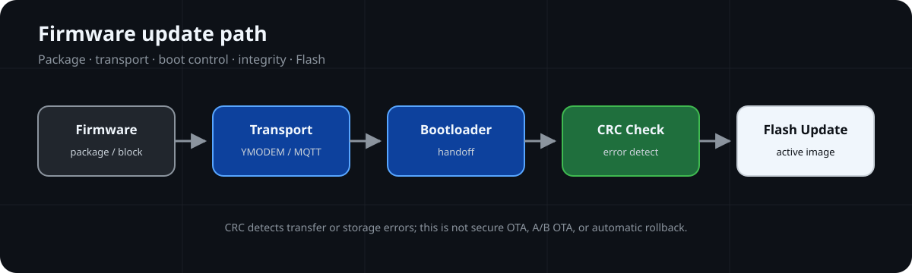
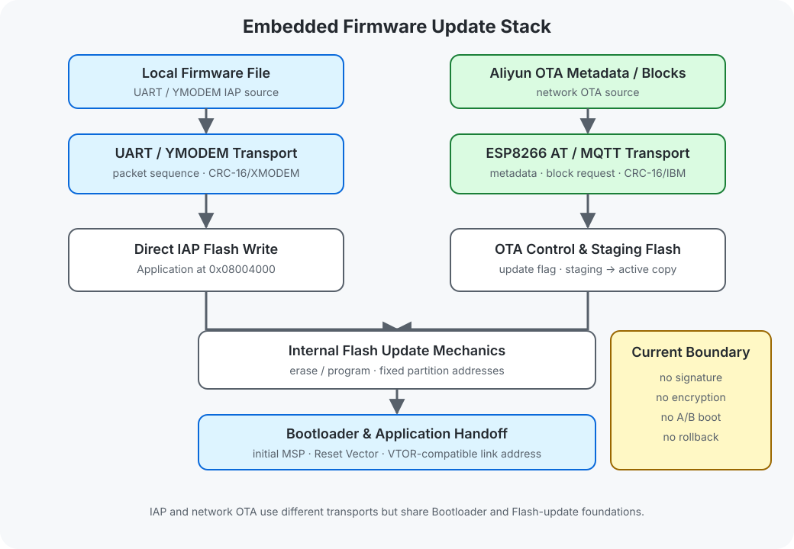

# Embedded-OTA-Update-Lab

面向 Cortex-M 的 Bootloader、Flash layout、UART/YMODEM、MQTT transport 与 CRC 边界架构文档实验。

**🔄 Update Pipeline**



## Update Snapshot

| Update Focus | Current Scope |
| --- | --- |
| Repository Type | Firmware Update Architecture Lab |
| Reference MCU | GD32F407VE / ARM Cortex-M4 |
| Local Path | UART / YMODEM IAP model |
| Network Path | MQTT block transport model |
| Integrity Boundary | CRC error detection；no authentication, encryption or rollback claim |
| Public Implementation | Host range planner, portable C validators, Flash simulator, and end-to-end OTA Host update model; no target firmware |
| Verification | Python range tests and C Host demo/tests；target build, device Flash-write and boot evidence not provided |

## 📌 Overview

仓库以原创文档和 SVG 描述 Bootloader / Application 边界、Flash 分区、向量跳转、UART/YMODEM IAP、MQTT 分块传输、更新元数据和 CRC 错误检测。

当前默认分支不分发课程 Bootloader、Flash/YMODEM/ESP8266/MQTT 应用代码、GD32/CMSIS 厂商组件、startup 或 Keil 工程。[Host 范围规划器](host_tools/flash_plan.py) 计算参考字节范围；[C 分块校验核心](docs/portable-block-validator.md)检查顺序、长度和块 CRC；[映像元数据核心](docs/image-manifest.md)检查格式、长度、软件版本下限和整包 CRC32。[Host 更新流程](docs/host-update-flow.md)将它们与模拟 Flash 串成可运行的升级闭环，不访问真实设备。Staging Backup 不是可启动 Slot B；不声明 A/B OTA、Automatic Rollback、Secure OTA、签名验证或生产级更新能力。

## 🏗️ Architecture



```text
                  ┌─ UART / YMODEM ─┐
Firmware Source ──┤                  ├── Flash / Staging ── CRC ── Boot Handoff
                  └─ MQTT Transport ─┘
```

UART/YMODEM 与 MQTT 是独立 transport model。CRC 只表达传输或存储错误检测，不提供来源认证、保密性或防回滚能力。

## ✨ Key Features

| Capability | Documentation Entry |
| --- | --- |
| Boot/Application boundary | [Bootloader Architecture](docs/bootloader-architecture.md) |
| Vector handoff | [Application Jump](docs/application-jump.md) |
| Flash partition model | [Flash Layout](docs/flash-layout.md) |
| UART/YMODEM model | [YMODEM IAP](docs/ymodem-iap.md) |
| MQTT block model | [MQTT Block Transport](docs/mqtt-block-transport.md) |
| Integrity and failure boundary | [Image Integrity](docs/image-integrity.md) and [Failure Boundaries](docs/failure-boundaries.md) |
| Portable receive validation | [Block Validator](docs/portable-block-validator.md) |
| Whole-image error detection | [Image Manifest](docs/image-manifest.md) |
| Storage boundary and fault injection | [Flash Port](docs/flash-port.md) |
| Integrated Host update and recovery | [Host Update Flow](docs/host-update-flow.md) |

## 📂 Project Structure

```text
Embedded-OTA-Update-Lab/
├── README.md
├── LICENSE
├── THIRD_PARTY_NOTICES.md
├── assets/images/  # Repository-authored architecture and flow SVG
├── docs/           # Firmware-update architecture documentation
├── host_tools/     # Host range model and simulated Flash
├── tools/          # Executable Host OTA demo
├── include/, src/  # Portable C validation/update core; no hardware adapter
└── tests/          # Python and C Host tests
```

## 📚 Documentation

- [Bootloader Architecture](docs/bootloader-architecture.md)
- [Flash Layout](docs/flash-layout.md)
- [Application Jump](docs/application-jump.md)
- [YMODEM IAP](docs/ymodem-iap.md)
- [OTA Control Plane](docs/ota-control-plane.md)
- [MQTT Block Transport](docs/mqtt-block-transport.md)
- [Image Integrity](docs/image-integrity.md)
- [Failure Boundaries](docs/failure-boundaries.md)
- [Development Environment](docs/development-environment.md)
- [Portable Block Validator](docs/portable-block-validator.md)
- [Image Manifest and CRC32](docs/image-manifest.md)
- [Flash Port and Host Simulator](docs/flash-port.md)
- [Host OTA Update Flow](docs/host-update-flow.md)

## 🧪 Verification

| Verification Layer | Status | Boundary |
| --- | --- | --- |
| Host Test | 7 Python tests plus C core/integration tests and executable demo | Range planning, receive, Staging, copy, CRC readback, Journal recovery, injected storage failures |
| Target Build Verification | NOT PROVIDED | No Keil project or target firmware source is distributed |
| Hardware Validation | NOT PROVIDED | No reviewable Flash, UART, network, or boot result |
| Device Runtime Evidence | NOT PROVIDED | No device transfer log, Flash trace, MQTT session, or boot record; Host demo is reproducible above |

在 Python 3.10+ 环境运行 `python -m unittest discover -s tests -v`。示例 `python -m host_tools.flash_plan 257` 打印参考字节范围。可复现的 C Demo 编译与三条运行路径见 [Host Update Flow](docs/host-update-flow.md)。Host 更新核心只操作注入的 Flash 接口；本仓库提供的是内存模拟器，没有目标 Flash 驱动。Host 测试不能证明设备端擦写、YMODEM/MQTT 兼容、整包认证、真实掉电恢复或实机升级成功。

## License Boundary

根目录 MIT License 仅覆盖当前默认分支中仓库维护者编写的文档、配置、自绘 SVG、Host 范围规划器、C 核心、Flash 模拟器及测试。课程源码、GD32/CMSIS、startup、Keil 工程和第三方 transport 实现未包含在当前默认分支；旧提交中的历史文件仍需单独评估。详见 [THIRD_PARTY_NOTICES.md](THIRD_PARTY_NOTICES.md)。
